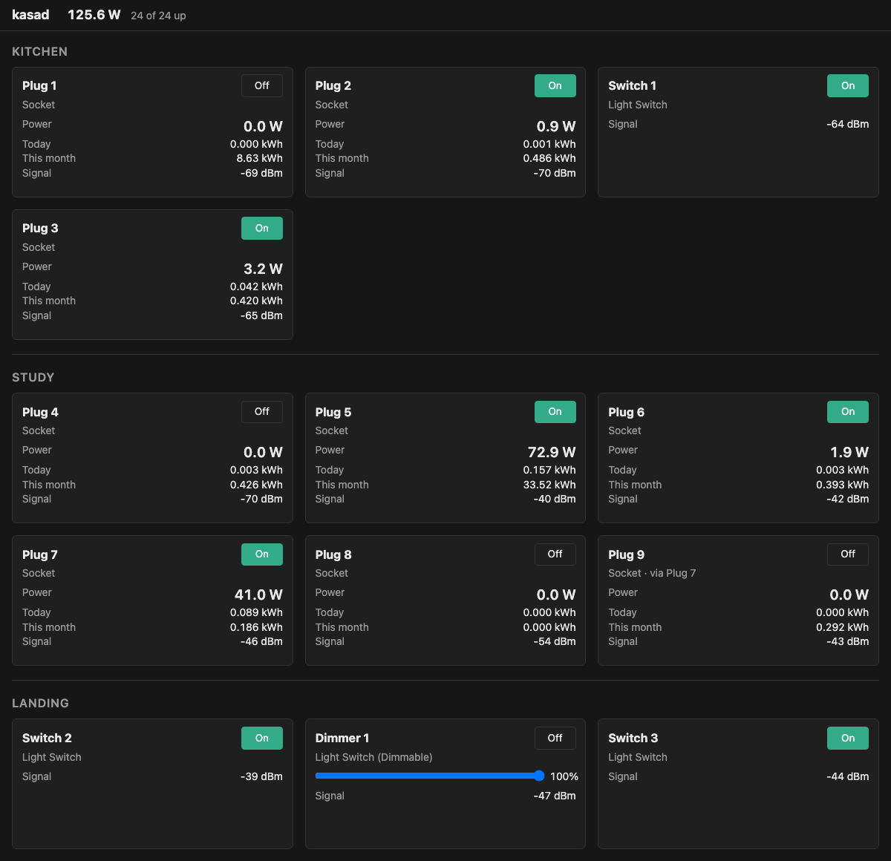
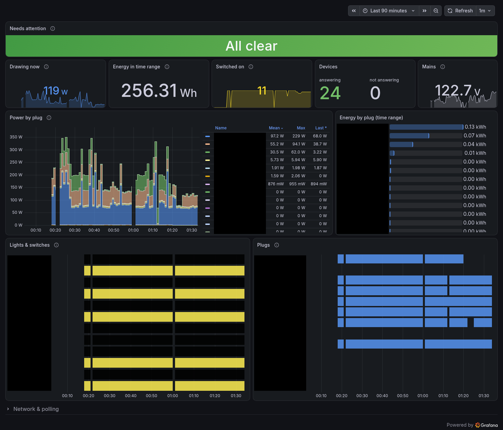

# kasad

A Prometheus exporter and small control page for TP-Link Kasa smart plugs and
switches. It finds devices on the LAN by itself, polls them in the background,
pushes every reading to Prometheus with remote write (at the time it was
taken), and shows them on a web page where each one can be switched on and
off. Go, with `prometheus/client_golang`,
templ and datastar like comfortd and breezyd.

## Screenshots

The control page (device names replaced with generic ones):



A Grafana dashboard built on the metrics (device names blacked out):



## What it reads

| Devices | Protocol | Needs a TP-Link login | Metrics |
|---|---|---|---|
| KP125 and other legacy plugs and switches (KS200, KS220, ...) | XOR over TCP 9999 | no | state, signal, uptime; power, voltage, current and energy on metered plugs |
| EP25 and other newer plugs | KLAP over HTTP | yes | the same |

Devices that speak both are polled over the legacy protocol, which needs no
account. Without `--credentials`, KLAP-only devices are skipped.

```
kasa_up{alias,host,model}                     1 if the last poll worked
kasa_last_success_timestamp_seconds
kasa_poll_errors_total
kasa_relay_on
kasa_power_watts  kasa_voltage_volts  kasa_current_amps
kasa_energy_watt_hours_total                  the device's own counter
kasa_on_time_seconds  kasa_brightness_percent  kasa_rssi_dbm
kasad_devices  kasad_build_info
```

`/metrics` serves the latest reading of every device: power, voltage,
current, energy, relay, on-time, brightness and RSSI, with the health:
`kasa_up`, `kasa_last_success_timestamp_seconds`, `kasa_poll_errors_total`
and `kasad_devices`.

With `--push name=url` (repeatable), every successful poll (every 15
seconds, and right after a switch from the page) is also pushed with remote
write, at the time it was taken, to each target: VictoriaMetrics, or
Prometheus with its receiver on. None are lost to a scrape interval that
differs from the poll's, and none are read twice. On `/metrics` the pushed
readings then carry `pushed_<name>="true"`, so the target's own scrape of
kasad can drop the copies it already has:

```yaml
metric_relabel_configs:
  - source_labels: [pushed_mytarget]
    regex: "true"
    action: drop
```

Any other scraper keeps them. Each target has its own queue
(`kasad_push_queued_samples{target}`, `kasad_push_errors_total{target}`): a
target that is away gets its readings when it is back, up to two hours'
worth.

Wi-Fi plugs are unreliable, so polling never waits on a scrape. When a device
stops answering, nothing more is pushed for it (a gap in the graph, not a flat
line of stale values), `kasa_up` goes to 0 and
`kasa_last_success_timestamp_seconds` says when it last worked. That lasts
until `--expire` (10m) has passed and the next discovery sweep (every 15m) runs,
so 10 to 25 minutes with the defaults. Then the device is forgotten: its series
stop, its card goes, and an alert on `kasa_up == 0` resolves by itself. Devices
in `--hosts` are never forgotten and keep `kasa_up 0`.

## Web UI

`/` is a page with a card per device: on/off switch, current power in W,
energy today and this month in kWh (as recorded by the device itself), and
Wi-Fi signal. Dimmers also have a brightness slider with the percentage beside it. The second line of each card says what the device is (Socket, Light Switch, Light Switch (Dimmable)), and all cards are the same size. The header shows the combined draw and how many devices answer.
It updates live (server-sent events), including changes made from the Kasa app
or a wall switch. A switch sends the state it wants, never a toggle, and the
card then shows what the device reports. Offline devices are dimmed and their
switch is disabled.

There is no login: put it behind something that is already restricted (it is
served at `kasad.wg` on a private network). Cross-site requests to the switch
are refused, so another website open in a browser on that network cannot drive
it. So are DNS-rebinding pages: the page's routes answer only when the request's
`Host` is an IP address, `localhost`, this machine's hostname or a name given in
`--allowed-hosts`. Reaching it by any other name (a reverse proxy's, say) gets a
403 that names the flag. `/metrics` and `/healthz` answer to any `Host`.

| Route | |
|---|---|
| `GET /` | the page |
| `GET /ui/sse` | live updates |
| `POST /ui/devices/{host}/relay?on=true\|false` | switch a device |
| `POST /ui/devices/{host}/brightness?pct=1..100` | set a dimmer's brightness (does not switch it on) |
| `GET /metrics`, `GET /healthz` | Prometheus, liveness |

### Rooms and downstream devices

Devices do not know their room or what is plugged into what, so that is
configuration: `--metadata file.json`, or the module's `rooms` and
`downstream` options.

```json
{
  "rooms": [
    {"name": "Kitchen", "devices": ["Kettle", "Fridge"]},
    {"name": "Study", "devices": ["Desk", "Speakers"]}
  ],
  "downstream": {"Speakers": "Desk"}
}
```

Names are the device names from the Kasa app, matched case-insensitively.
Rooms appear in the order listed; devices not listed go in a trailing "Other"
section, and a device named in two rooms stays in the first. `downstream` marks
a device plugged into another metered one: its power is left out of the
header's combined total while the upstream device is up (that reading already
includes it), and its card says "via ...". An unknown key or an unreadable file
stops kasad at startup; names that match no device are logged as a warning
after two minutes. Without the flag the page is one ungrouped grid.

### Firewall

Discovery replies arrive from UDP source ports 9999 and 20002, which a
connection-tracking firewall treats as unsolicited and drops. On such a host
allow them in, for example with nftables `udp sport { 9999, 20002 } accept` on
the LAN interface. The module's `openFirewall` only opens the page's TCP port.

## Grafana dashboard

`grafana/kasad.json` is the dashboard in the second screenshot. In Grafana:
Dashboards, New, Import, upload the file, and pick your Prometheus data source
when asked (it is an input, so nothing in the file is tied to one Grafana).

- **Needs attention:** a green "All clear", or one line per problem device: not
  answering, no good poll for two minutes, Wi-Fi weaker than -75 dBm, mains
  outside 114-126 V, or more than ten failed polls in the last hour. A dead
  device leaves the strip when it is forgotten (see above); for one that must
  not go quiet, list it in `--hosts` or alert on `absent` for its series.
- **Summary row:** combined draw, energy in the selected time range, relays on,
  devices answering, mains voltage.
- **Per device:** power stacked by plug with a mean/max/last table, energy per
  plug, and on/off timelines for plugs and for wall switches (dimmers shaded by
  brightness).
- **Network & polling** (collapsed row): Wi-Fi signal per device, mains voltage
  range, and failed polls.

It assumes models starting `KS` are wall switches (no power meter) and treats
every other model as a plug. "Drawing now" and "Power by plug" add up every
metered plug, so a plug fed from another metered plug is counted twice there;
the control page's header avoids that with its `downstream` setting, the
dashboard does not. `go test` checks that every `kasa_` metric the dashboard
queries still exists.

## Running

```
kasad --broadcast 192.168.1.255 --credentials ./creds   # creds: email, then password
curl localhost:9881/metrics
```

| Flag | Default | |
|---|---|---|
| `--listen` | `127.0.0.1:9881` | HTTP address for the page, `/metrics` and `/healthz` |
| `--broadcast` | `255.255.255.255` | comma-separated discovery targets. On a host with several interfaces, name the LAN's broadcast address |
| `--hosts` | | devices to poll even if discovery misses them |
| `--allowed-hosts` | | comma-separated names the page may be reached by, besides IP addresses, `localhost` and this machine's hostname (for example `kasad.wg` behind a reverse proxy); other names get a 403 |
| `--credentials` | | TP-Link account file for newer devices |
| `--poll-interval` | `15s` | |
| `--discover-interval` | `15m` | how soon a new device, or one with a new address, appears |
| `--expire` | `10m` | forget a discovered device after this long unheard (checked at each discovery sweep; devices in `--hosts` are never forgotten) |
| `--push` | | `name=url` of a remote write receiver to push every reading to; repeatable |
| `--job` | `kasad` | `job` label on pushed series |

Discovery packets get lost on Wi-Fi, so each probe is sent twice and devices
are only dropped after `--expire` without a reply to discovery or to a poll.
A device that answers its polls never expires, so discovery only has to find
new ones.

## NixOS

The flake has a package and a NixOS module. Add it as an input and put the
module in your system's `modules` list:

```nix
# flake.nix
{
  inputs = {
    nixpkgs.url = "github:NixOS/nixpkgs/nixos-unstable";
    kasad = {
      url = "github:hughobrien/kasad";
      inputs.nixpkgs.follows = "nixpkgs";
    };
  };

  outputs = { nixpkgs, kasad, ... }: {
    nixosConfigurations.myhost = nixpkgs.lib.nixosSystem {
      system = "x86_64-linux";
      modules = [
        kasad.nixosModules.default # services.kasad.package defaults to this flake's build
        ./configuration.nix
      ];
    };
  };
}
```

Then configure it, for example in `configuration.nix`:

```nix
{
  services.kasad = {
    enable = true;
    broadcast = [ "192.168.1.255" ];             # your LAN's broadcast address
    credentialsFile = "/etc/kasad/credentials";  # only for KLAP devices (EP25 and newer)
    prometheus.enable = true;                    # push to and be scraped by the local store
  };
  services.victoriametrics.enable = true;
  # Or Prometheus with the receiver on; set the flag once, even if several
  # exporters push: Prometheus refuses it twice.
  # services.prometheus.extraFlags = [ "--web.enable-remote-write-receiver" ];

  # Let discovery replies in (see Firewall above).
  networking.nftables.enable = true;
  networking.firewall.extraInputRules = ''
    iifname "eth0" udp sport { 9999, 20002 } accept
  '';
}
```

The credentials file holds the TP-Link account email on the first line and
the password on the second. systemd hands it to the service
(`LoadCredential`), so it can stay root-only:

```sh
sudo install -d -m 700 /etc/kasad
sudo install -m 600 /dev/null /etc/kasad/credentials
sudoedit /etc/kasad/credentials
```

After `nixos-rebuild switch`, the page and `/metrics` are on
http://127.0.0.1:9881/.

| Option | Default | |
|---|---|---|
| `listen` | `"127.0.0.1:9881"` | page, `/metrics` and `/healthz` |
| `broadcast` | `[ "255.255.255.255" ]` | discovery targets; name the LAN's broadcast address on a multi-homed host |
| `hosts` | `[ ]` | devices to poll even if discovery misses them |
| `allowedHosts` | `[ ]` | names the page may be reached by besides IPs, `localhost` and the machine's hostname; set it to the reverse proxy's name |
| `credentialsFile` | `null` | TP-Link account file; without it KLAP-only devices are skipped |
| `pollInterval`, `discoverInterval`, `expire` | `"15s"`, `"15m"`, `"10m"` | Go durations |
| `rooms` | `[ ]` | group the page's cards: `[ { name = "Kitchen"; devices = [ "Kettle" ]; } ]` |
| `downstream` | `{ }` | devices plugged into another metered device: `{ "Speakers" = "Desk"; }` |
| `push.<name>.url` | `{ }` | more remote write targets; their hosts' scrapes should drop `pushed_<name>` |
| `prometheus.enable` | `false` | push to the local `services.victoriametrics` (else `services.prometheus`) and register a scrape job that drops what it was pushed; for Prometheus, asserts the receiver flag |
| `prometheus.pushName` | host name, `-` and `.` as `_` | the local target's name |
| `prometheus.url` | from the local store | where to push |
| `prometheus.jobName`, `.scrapeInterval` | `"kasad"`, `"60s"` | the `job` label (scraped and pushed), scrape interval |
| `openFirewall` | `false` | open the TCP port of `listen` |
| `extraArgs` | `[ ]` | extra command-line flags |

## Development

`go test ./...`. After editing a `.templ` file run `just generate` (templ 0.3.1118, the version the flake pins) and commit the `*_templ.go` files. The hermetic CI gate is `nix build .#checks.x86_64-linux.gate .#checks.x86_64-linux.module`
(Go checks, then an evaluation of the NixOS module; `just gate` runs both on a remote Nix host).

Licensed GPL-3.0-or-later.
